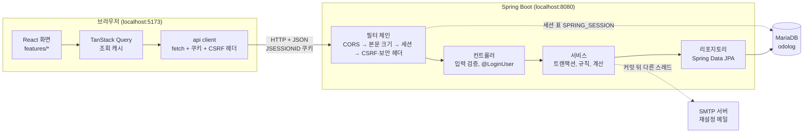
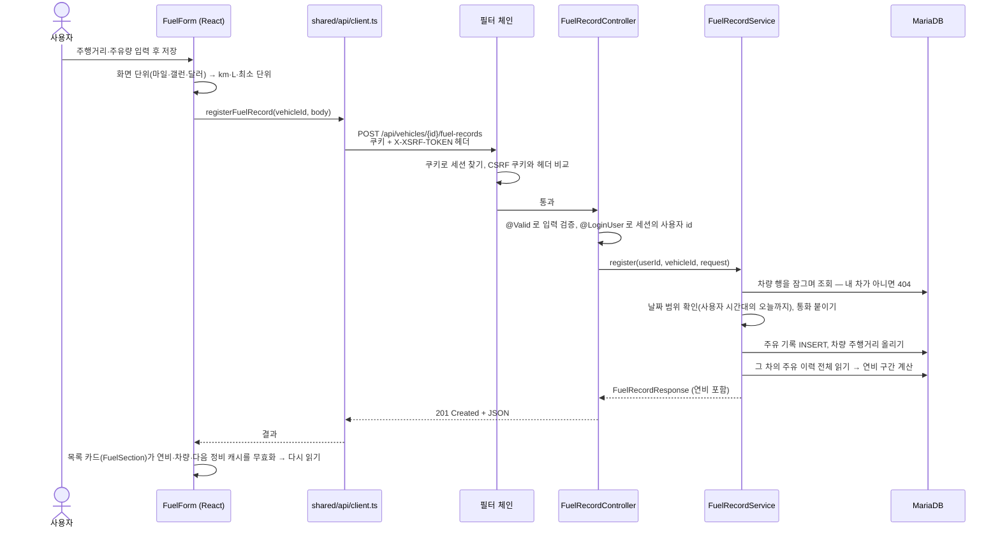
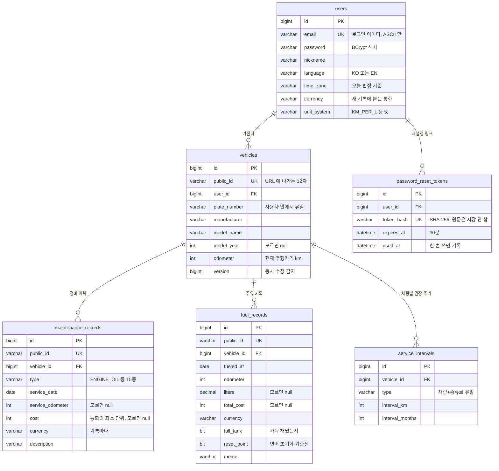
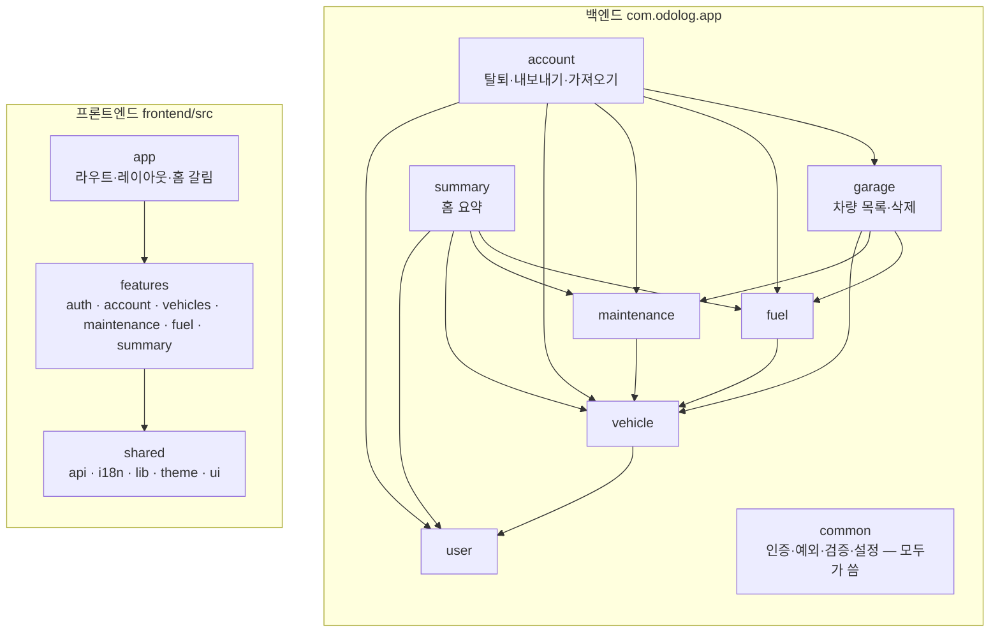

# 오도로그 (OdoLog)

차량 정비 이력과 주유 기록을 관리하는 웹 앱. 기록이 쌓이면 **연비(km/L)** 와
**다음 정비 시점**(주행거리 기준·날짜 기준)이 계산된다.

Spring Boot 3.5 + MariaDB 백엔드에 React 19 SPA 를 붙인 구성이고, 인증은 **세션 쿠키**다.
한국어·영어 두 벌이고, 계정마다 언어·시간대·통화·단위(km/L · L/100km · mpg)를 따로 가진다.
**이미 타던 차**를 등록하는 경우를 기본으로 본다 — 현재 주행거리와 기억나는 정비 몇 가지만 적으면
다음 정비 시점이 바로 뜨고, 이후 주유·정비를 적을 때마다 기록이 쌓인다.

백엔드 API 29개 · 화면 12 라우트가 동작하고, 테스트 562개(백엔드 445 · 프론트 117)와 실제 브라우저 E2E 19개가 통과한다.
플랫폼은 웹 하나다(근거는 `HISTORY.md` 의 2026-09-16 항목). 개인 학습 프로젝트라
**로컬에서 완전히 동작하는 것**까지가 범위이고 배포는 아직 하지 않았다 — "올린다면"은 운영 프로파일로 준비해 뒀다.

| 문서 | 내용 |
|---|---|
| `README.md`(이 파일) | 처음 보는 사람을 위한 지도·전체 흐름·기능별 설명, 실행 방법, API, 보안 |
| `CLAUDE.md` | 지금 지켜야 할 설계 원칙과 그 이유, 폴더 지도, 의존 방향 |
| `docs/DESIGN.md` | 프론트엔드 디자인 시스템 |
| `docs/QA.md` | 로드맵, 눈 확인 체크리스트, 발견한 문제(6-F), 완료 판정 기준, 백로그 |
| `HISTORY.md` | 작업 일지 — 무엇을 왜 그렇게 정했는지(최신순) |

## 처음 읽는다면

이 순서로 읽으면 된다.

1. **[전체 지도](#전체-지도)** — 그림 넷. 무엇이 어디서 돌고, 요청 하나가 어떻게 지나가는지
2. **[전체 로직 — 사용자의 하루를 따라가기](#전체-로직--사용자의-하루를-따라가기)** — 가입부터 탈퇴까지 각 장면에서 코드의 어디가 일하는지
3. **[기능별 설명](#기능별-설명)** — 폴더 하나씩. 하는 일, 주요 파일, 지키는 규칙
4. 코드를 직접 열 때는 **테스트부터** 본다. 테스트 이름(`@DisplayName`, `it('…')`)이 곧 "이 코드가 지키는 약속"의 목록이다

용어 몇 개:

| 용어 | 뜻 |
|---|---|
| 엔티티 | DB 표 한 줄을 자바 객체로 나타낸 것(`User`, `Vehicle` …). JPA 가 표와 객체를 오간다 |
| 리포지토리 | DB 를 읽고 쓰는 창구. 메서드 이름만 적으면 Spring Data 가 SQL 을 만든다 |
| 서비스 | 규칙을 실행하는 곳. 트랜잭션(전부 되거나 전부 안 되거나)의 경계 |
| 컨트롤러 | URL 과 서비스를 잇는 곳. 입력 검증과 HTTP 상태 코드 |
| DTO | 요청·응답에 실리는 모양. 엔티티를 그대로 내보내지 않으려고 따로 둔다 |
| 공개 id | URL 에 나가는 12자 무작위 문자열(`k3Xq9mTa2LpZ`). DB 의 숫자 id 는 밖으로 내보내지 않는다 |
| 조율 층 | 여러 기능을 동시에 알아야 하는 일(탈퇴, 홈 요약)을 맡는 패키지. `garage`·`account`·`summary` |

## 전체 지도

### 1. 시스템 구성 — 무엇이 어디서 도는가



- **화면과 서버는 완전히 다른 프로그램이다.** 화면(`frontend/`)은 Vite 가 띄우는 React 앱이고, 서버(`src/`)는 Spring Boot 앱이다.
  둘은 HTTP 로 JSON 을 주고받을 뿐 서로의 빌드에 관여하지 않는다
- **로그인 상태는 서버의 세션에 있다.** 브라우저는 `JSESSIONID` 쿠키만 들고 다니고, 서버는 그 쿠키로 DB 의 세션 표를 찾아
  "이 요청은 사용자 7번"을 안다. 그래서 서버를 재시작해도 로그인이 유지된다
- **스키마는 Flyway 가 만든다.** `src/main/resources/db/migration/V1…V6` 을 순서대로 실행해 표를 만들고, Hibernate 는 엔티티와 표가 맞는지 확인만 한다
- 화면이 보여 주는 숫자(연비, 다음 정비, 홈 통계)는 **전부 서버가 계산**해서 준다. 화면은 단위·통화 표기만 바꾼다

### 2. 요청 하나가 지나가는 길 — "주유 기록 저장"



모든 쓰기 요청이 이 모양이다. 기억할 점 셋:

1. **"누구의 요청인가"는 세션에서만 꺼낸다**(`@LoginUser`). 요청 본문의 사용자 id 는 믿지 않는다 — 조작할 수 있다
2. **"내 차인가"는 서비스의 첫 조회가 확인한다**(`findOwnedVehicleForUpdate`). 남의 차는 403 이 아니라 404 — "있긴 하다"도 알려 주지 않는다
3. **실패는 예외로 던지고 `GlobalExceptionHandler` 가 HTTP 응답으로 바꾼다.** 응답 본문은 늘 `{code, message, field?}` 이고,
   화면은 `code` 로 자기 언어의 문구를 고른다

### 3. 데이터 모델 — 표 여섯 개



- **저장 단위는 하나다** — 거리는 km, 부피는 L, 금액은 통화의 최소 단위 정수(원화는 원, 달러는 센트). 마일·갤런·달러 표기는 화면이 바꾼다
- **계산값은 표에 없다** — 연비, 구간 거리, 단가, 다음 정비 시점, 지남/곧은 읽을 때마다 계산한다. 앞 기록이 바뀌면 뒤의 값이 따라 바뀌기 때문이다
- **모르는 값은 `0` 이 아니라 `null`** — `0원` 은 "공짜로 했다"는 다른 사실이고, 주유량 0 은 연비를 0 으로 나누게 만든다
- 모든 표에 `created_at`·`updated_at` 이 있다(`BaseTimeEntity` 를 상속하면 저절로 채워진다). 세션은 Spring Session 이 만드는 `SPRING_SESSION`·`SPRING_SESSION_ATTRIBUTES` 두 표에 따로 있다

### 4. 코드 의존 방향 — 누가 누구를 아는가



화살표는 한 방향으로만 흐른다. `user` 는 `vehicle` 을 모르고, `shared` 는 `features` 를 모른다.
그림은 읽기 쉽게 줄인 것이고, 정확한 허용 목록은 이렇다(`DependencyDirectionTest` 와 같다).

| 패키지 | 가져다 쓸 수 있는 패키지 |
|---|---|
| `common` | (없음) |
| `user` | `common` |
| `vehicle` | `common` · `user` |
| `maintenance` · `fuel` | `common` · `user` · `vehicle` |
| `garage` · `summary` | `common` · `user` · `vehicle` · `maintenance` · `fuel` |
| `account` | 위 전부 + `garage` |

프론트 기능 사이에서는 `vehicles → maintenance·fuel`(상세 화면이 두 카드를 얹음), `account → auth`, `summary → maintenance`(정비 종류 타입만)가 허용된다.
"회원 탈퇴"처럼 차·정비·주유를 모두 지워야 하는 일을 `UserService` 에 넣으면 거꾸로 가는 화살표가 생긴다 — 그래서 그런 일은
**조율 층**(`account`·`garage`·`summary`)이 맡는다. 이 방향은 **테스트가 지킨다**: 백엔드 `DependencyDirectionTest`, 프론트
`src/dependency-direction.test.ts` 가 import 를 훑어 허용 목록 밖이면 실패한다.

## 전체 로직 — 사용자의 하루를 따라가기

처음 보는 사람이 전체를 한 번에 잡을 수 있게, 한 사용자가 앱을 쓰는 순서대로 각 장면에서 무슨 일이 일어나는지 따라간다.
괄호 안은 그 일을 하는 코드다.

### 1. 처음 방문 — 랜딩

`/` 는 로그인 여부와 차량 수에 따라 세 갈래다(`app/HomePage`). 로그인 전이면 소개 화면(`LandingPage`),
로그인했는데 차가 없으면 등록 권유, 차가 있으면 대시보드. 화면은 라우트 단위로 나눠 받는다 — 첫 화면에 필요한 것만 먼저 내려온다(`App.tsx` 의 `lazy`).

### 2. 회원가입 → 자동 로그인

1. 가입 화면이 브라우저의 언어·시간대·지역을 읽어 설정 넷을 함께 보낸다(`shared/lib/preferences`). 미국 사용자가 서울 시간·원화로 시작하지 않게
2. 서버는 이메일 중복을 보고(있으면 409), 비밀번호를 **BCrypt** 로 해시해 저장한다(`UserService.signUp`). 원문 비밀번호는 어디에도 남지 않는다.
   같은 IP 에서 가입을 너무 많이 시도하면 429 — 남의 주소가 가입돼 있는지 쓸어 보는 것을 막는다
3. 가입은 세션을 만들지 않으므로 화면이 이어서 로그인을 부른다

### 3. 로그인 — 세션이 생기는 순간

1. 시도 횟수를 **먼저** 센다(`LoginAttemptLimiter`). 10분 안에 10번 넘게 틀리면 잠긴다
2. 이메일로 사용자를 찾아 BCrypt 로 비밀번호를 맞춰 본다. 없는 이메일이어도 가짜 해시로 한 번 돌린다 — 응답 시간으로 가입 여부가 새지 않게
3. 맞으면 **세션 id 를 새로 바꾸고**(고정 공격 방어) 세션에 사용자 id 하나만 넣는다(`LoginService`). 세션은 DB 표에 저장되고 14일 간다
4. 응답의 `Set-Cookie: JSESSIONID=…` 를 브라우저가 기억해 이후 모든 요청에 붙인다. `XSRF-TOKEN` 쿠키도 받아 두었다가 쓰기 요청마다 헤더로 되돌려 보낸다(CSRF 방어)
5. 화면은 `AuthContext` 에 사용자를 올리고, **조회 캐시를 통째로 비운다** — 앞 사람이 쓰던 탭이면 그 사람의 차가 캐시에 남아 있을 수 있다

새로고침하면 화면은 `GET /api/users/me` 로 "나 아직 로그인돼 있나"를 묻는다. 보호된 주소(`/vehicles`, `/me`)는 `ProtectedRoute` 가
로그인 화면으로 돌려보내고, 로그인하면 원래 주소로 돌아온다.

### 4. 차량 등록 — 타던 차 그대로

1. 번호판·제조사·모델·연식·**현재 주행거리**를 적는다. 서버는 앞뒤 공백·보이지 않는 글자를 정리하고(`InputText`) 번호판의 가운데 공백까지 지운다 —
   `33나 3333` 과 `33나3333` 이 다른 차로 들어가지 않게
2. 같은 사용자 안에서 번호판이 겹치면 409. "같은가"는 자바가 아니라 DB 가 판단한다(대소문자·전각 숫자까지 같게 보는 정렬 규칙)
3. 저장되면 12자 **공개 id** 가 붙고, 화면은 `/vehicles/{공개 id}` 로 간다

### 5. 차량 상세 — 앱의 중심 화면

한 화면에 카드 여럿이 얹힌다(`VehicleDetailPage`):

| 카드 | 하는 일 | 서버 |
|---|---|---|
| 주행거리(큰 숫자)·갱신 폼 | 계기판 숫자를 적는다. 줄이면 409 — 자리수 오타만 확인 창을 거쳐 낮출 수 있다 | `vehicle` |
| 차량 정보 | 번호판·모델 등 수정 | `vehicle` |
| 시작하기 | 4단계 안내(주행거리 → 기억나는 정비 → 첫 주유 → 첫 연비). 빠른 정비 폼이 여기 있다 | 여러 조회를 합침 |
| 다음 정비 시점 | 종류마다 "언제·몇 km 에" 와 `지남`/`곧`. 차량별 주기를 바꾼다 | `maintenance` |
| 정비 이력 | 목록·추가·수정·삭제, 종류로 거르기 | `maintenance` |
| 연비 | 평균, 최근 구간 추이, 합계, 연비 초기화 | `fuel` |
| 주유 기록 | 목록·추가·수정·삭제. 행마다 그 구간의 연비 | `fuel` |
| 차량 삭제 | 정비·주유·주기를 먼저 지우고 차를 지운다 | `garage` |

각 카드는 TanStack Query 로 따로 읽고, 키가 모두 `['vehicles', 공개 id, …]` 아래에 있다. 무언가를 저장하면
`invalidateAfterFuel`·`invalidateAfterMaintenance` 가 "다시 읽을 카드"를 한 곳에서 정한다 — 주유가 주행거리를 올리면 다음 정비 판정도 바뀌므로 그 카드까지.

### 6. 정비 기록과 "다음 정비 시점"

1. **빠른 정비**: 엔진오일·타이어 등 다섯 종류를 "모름 / 3개월 전 / 6개월 전 / 1년 전 / 날짜 지정"으로 한 번에 적는다. 비용·주행거리는 몰라도 된다
2. 정비를 저장하면 서버는 그때 주행거리가 차량보다 크면 차량 주행거리도 올린다(`liftOdometerTo`)
3. 다음 정비는 저장하지 않고 **물을 때마다 계산한다**(`NextService`): 종류별 마지막 정비 + 권장 주기 → "주행거리 기준"과 "날짜 기준" 두 시점.
   지났으면 `지남`, 1,000km 또는 한 달 안이면 `곧`. "오늘"은 서버 시계가 아니라 **사용자 시간대의 오늘**이다(`UserToday`)
4. 권장 주기는 `ServiceType` enum 에 기본값이 있고(엔진오일 5,000km·6개월 등), 차량마다 바꾸면 `service_intervals` 에 저장된다

### 7. 주유 기록과 연비

1. 주유마다 날짜·주행거리·주유량·금액·"가득 채움"을 적는다. 주유량·금액은 비워도 된다
2. 저장하면 서버는 그 차의 주유 이력 전체를 주행거리 순으로 읽어 **가득 → 가득** 구간을 다시 계산한다(`FuelSegment`).
   덜 채운 주유는 다음 가득 주유의 구간에 합쳐진다
3. 평균 연비(`FuelEfficiency`)는 말이 안 되는 구간(200 km/L 같은 오타)과 기록이 빠진 것으로 보이는 구간을 **빼고** 낸다.
   뺀 구간도 목록에서 지우지 않고 `확인 필요`·`기록 빠짐?` 을 붙인다
4. `연비 초기화`는 가장 최근 기록을 기준점으로 삼아 그 앞의 구간을 평균에서 뺀다(엔진 교체 뒤 등). 기록은 그대로다

자세한 계산 규칙은 아래 [fuel](#fuel--주유와-연비) 절에 있다.

### 8. 홈 대시보드

`GET /api/summary` 한 번으로 다 받는다(`HomeSummaryService`) — 차량 수·총 주행거리·기록 수·유지비, 지난 12개월 월별 유지비,
정비 종류별 비용, 최근 활동, 차량별 요약(지남/곧 수·평균 연비). 계산은 전부 서버가 하고, 합계는 **사용자 통화의 기록만** 더한다
(원화와 달러를 그냥 더하면 뜻이 없다).

### 9. 설정 바꾸기 — 언어·시간대·통화·단위

`/me` 에서 바꾼다. 단위를 마일로 바꿔도 **저장값은 그대로 km** 이고 화면만 바뀐다. 통화를 바꿔도 **옛 기록의 통화는 그대로**다 —
기록마다 통화를 들고 있어서, 옛 50,000원이 갑자기 $500.00 이 되지 않는다. 설정을 바꾸면 화면은 차량 관련 캐시를 버리고 새로 읽는다.

### 10. 내보내기·가져오기

- **내보내기**: 내 차량·정비·주유·차량별 주기·기준점을 JSON 파일로 받는다. 계산값과 비밀번호 해시는 넣지 않는다(`AccountExportService`)
- **가져오기**: 그 파일을 내 계정에 **더한다**. 같은 번호판의 차가 있으면 새 차를 만들지 않고 그 차에 붙이고, 이미 있는 기록은 건너뛴다.
  등록과 같은 규칙(날짜 범위·통화·문자열 정리)을 다시 적용한다(`AccountRestoreService`). 한 번에 차량 50대·기록 2만 건까지

### 11. 비밀번호를 잊었을 때

1. 이메일을 넣으면 **가입 여부와 상관없이** 늘 같은 응답(204)을 준다. 실제 일(사용자 찾기·토큰 저장·메일)은 **다른 스레드**가 한다 —
   가입된 주소만 늦게 답하면 그 시간 차이로 가입 여부가 샌다(`PasswordResetService.request`)
2. 토큰은 256비트 난수다. 메일에는 원문을, DB 에는 SHA-256 해시만 저장한다. 30분·한 번만 쓸 수 있다
3. 링크로 새 비밀번호를 정하면 그 계정의 **모든 세션을 끊는다**. 자동 로그인하지 않고 로그인 화면으로 보낸다

### 12. 로그아웃·탈퇴

- **로그아웃**: 서버 세션을 지운다. 서버에 닿지 못하면 화면도 로그인 상태를 유지하고 알린다 — 공용 PC 에서 로그아웃된 줄 알고 떠나지 않게
- **탈퇴**: 비밀번호를 한 번 더 확인하고, 정비·주유·주기 → 차량 → 재설정 토큰 → 사용자 순서로 지운 뒤 모든 세션을 끊는다(`AccountWithdrawalService`).
  순서가 중요한 이유는 외래키다 — 차를 먼저 지우면 그 차를 가리키는 기록 때문에 DB 가 거절한다

## 기능별 설명

### 백엔드 — 패키지 하나의 모양

모든 기능 패키지가 같은 모양이라, 어느 기능을 열어도 같은 자리에 같은 것이 있다.

    <feature>/
    ├── domain/            엔티티 · enum · 값 계산(NextService, FuelEfficiency 처럼 엔티티가 아닌 계산도 여기)
    ├── dto/request/       클라이언트가 보내는 모양. @NotBlank 같은 검증 애노테이션은 여기에만
    ├── dto/response/      서버가 돌려주는 모양. 엔티티에서 만드는 from()/of()
    ├── XxxRepository.java DB 창구
    ├── XxxService.java    규칙·트랜잭션
    └── XxxController.java URL ↔ 서비스

테스트는 대상과 같은 경로에 있다(`user/UserServiceTest`, `fuel/domain/FuelEfficiencyTest`).

### `user` — 회원과 설정

| | |
|---|---|
| 하는 일 | 가입, 로그인, 내 정보·설정 넷(언어·시간대·통화·단위) 조회·수정, 비밀번호 변경, 비밀번호 재설정 |
| 엔티티 | `User`, `PasswordResetToken`. enum `Language`·`UnitSystem` 은 `@Convert` 로 문자열 저장 |
| 주요 파일 | `UserService`(가입·로그인 검증·변경), `LoginService`(세션 만들기), `PasswordResetService`·`PasswordResetMailer`(재설정), `UserToday`(사용자 시간대의 오늘) |
| API | `POST /api/users`, `POST /api/users/login`·`logout`, `GET·PATCH /api/users/me`, `PATCH /api/users/me/password`, `POST·PATCH /api/users/password-reset` |

지키는 규칙:
- **BCrypt 는 트랜잭션 밖에서 돌린다.** 한 번에 수십 ms 걸리는데 그동안 DB 커넥션(풀 10개)을 쥐고 있으면 틀린 로그인 몇 개로 다른 API 가 멈춘다
- **비밀번호 상한은 글자 수가 아니라 UTF-8 72바이트**다. BCrypt 가 그 뒤를 읽지 않아서, 가입·변경·재설정이 같은 기준을 쓴다
- 비밀번호를 바꾸면 **지금 세션만 남기고** 다른 기기를 끊는다. 현재 비밀번호를 거듭 틀리면 막힌다 — 훔친 세션으로 비밀번호를 대입하지 못하게
- 로그인은 세션을 저장한 **뒤** 비밀번호가 그대로인지 한 번 더 본다. 맞춰 보는 0.06초 사이에 재설정이 끝났으면 그 세션은 무효다
- `UserToday` — 미래 날짜 판정, 정비 지남, 홈 월별 칸이 모두 이 "오늘"을 쓴다. 한 곳이라도 서버 시계를 쓰면 화면마다 오늘이 갈린다

### `vehicle` — 차량

| | |
|---|---|
| 하는 일 | 차량 등록·상세·정보 수정·주행거리 갱신 |
| 엔티티 | `Vehicle`(`@Version` — 두 탭에서 동시에 고치면 늦은 쪽이 409) |
| 주요 파일 | `VehicleService`(`findOwnedVehicle`·`findOwnedVehicleForUpdate` — 다른 기능이 "내 차인가"를 물을 때 쓰는 입구) |
| API | `POST /api/vehicles`, `GET·PATCH /api/vehicles/{id}`, `PATCH /api/vehicles/{id}/odometer` |

지키는 규칙:
- **주행거리 메서드가 셋이다.** 의도가 다르기 때문이다
  - `updateOdometer` — 사용자가 직접 적음. 줄이면 409
  - `liftOdometerTo` — 정비·주유를 적다가 따라 올라감. 작으면 아무 일도 안 함
  - `correctOdometer` — 자리수 오타 정정. `force: true` 로만 닿는다
- 상한 200만 km. 차량 주행거리는 기록을 따라 오르기만 해서, 한 번 크게 잘못 들어가면 되돌릴 길이 없다
- `vehicle` 은 `user` 만 안다. 정비·주유를 모른다 — 그래서 차량 삭제(기록까지 지워야 함)는 `garage` 가 한다

### `maintenance` — 정비 이력과 다음 정비

| | |
|---|---|
| 하는 일 | 정비 이력 등록·목록(종류로 거르기)·수정·삭제, 다음 정비 시점, 차량별 권장 주기 |
| 엔티티·값 | `MaintenanceRecord`, `ServiceInterval`, enum `ServiceType`(15종), 계산 `NextService` |
| 주요 파일 | `MaintenanceRecordService` |
| API | `POST·GET …/maintenance-records`, `PATCH·DELETE …/maintenance-records/{recordId}`, `GET …/next-services`, `PATCH …/intervals/{type}` |

정비 종류와 기본 주기(`ServiceType`):

| 종류 | 주기 | 종류 | 주기 |
|---|---|---|---|
| 엔진오일 | 5,000km · 6개월 | 타이어 | 50,000km · 4년 |
| 미션오일 | 60,000km · 4년 | 타이어 위치 교환 | 10,000km · 6개월 |
| 점화 플러그 | 80,000km · 4년 | 휠 얼라인먼트 | 20,000km · 1년 |
| 타이밍 벨트 | 100,000km | 에어 필터 | 20,000km · 1년 |
| 냉각수 | 40,000km · 2년 | 에어컨 필터 | 15,000km · 1년 |
| 브레이크 패드 | 20,000km · 2년 | 배터리 | 30,000km · 3년 |
| 브레이크액 | 40,000km · 2년 | 와이퍼 | 1년 |
| | | 기타 | 없음(계산 안 함) |

다음 정비 시점(`NextService`):
- 종류마다 **마지막 정비**에 주기를 더해 **두 기준을 모두** 내려보낸다. 먼저 오는 쪽이 실제 시기다
- 지났으면 **`지남`**, 1,000km 또는 한 달 안(주기의 마지막 1/5 이내)이면 **`곧`**. 정렬은 지남 → 곧 → 나머지이고, 지남·곧 안에서는 급한 순
- 차량 목록과 홈에도 `정비 N건 지남/곧` 이 붙는다. 세 화면이 같은 `NextService` 를 쓴다 — 두 벌이면 한 화면은 지났다 하고 다른 화면은 말이 없다
- 기본 주기는 광유 기준이라 엔진오일이 5,000km 다. 합성유를 쓰면 차량마다 주기를 바꾼다 — 손잡이가 없으면 `지남` 이 늘 켜져 아무도 안 보는 경고등이 된다
- 정비의 비용·그때 주행거리는 비워도 된다. 주행거리가 비면 날짜 기준만 계산한다. **이력이 없는 종류는 응답에서 뺀다**
- 색을 늘리지 않고 대비로 표현한다 — 빨강은 "실패"이고, 정비 시기가 지난 것은 실패가 아니라 할 일이다

### `fuel` — 주유와 연비

| | |
|---|---|
| 하는 일 | 주유 기록 등록·목록·수정·삭제, 연비 요약, 연비 초기화 기준점 |
| 엔티티·값 | `FuelRecord`, 계산 `FuelSegment`(구간 순회) → `FuelEfficiency`(평균·추이), `FuelAnomaly`(이상 구간 판정) |
| 주요 파일 | `FuelRecordService` |
| API | `POST·GET …/fuel-records`, `PATCH·DELETE …/fuel-records/{recordId}`, `GET …/fuel-records/summary` |

연비는 **구간(segment) 단위**로 계산한다. 구간은 **가득 주유에서 다음 가득 주유까지**다.

    구간 연비 = (이번 가득 주행거리 − 직전 가득 주행거리) ÷ (사이의 덜 채운 양 + 이번 주유량)
    평균 연비 = Σ(구간 거리) ÷ Σ(구간 주유량)

총 거리 ÷ 총 주유량과 값은 같지만, **구간 단위라야 말이 안 되는 구간을 골라낼 수 있다.**

- **덜 채운 주유**는 다음 가득 주유의 구간에 합쳐진다 — 그 자리에서 나누면 그 구간은 높게, 다음 구간은 낮게 나온다
- **같은 주행거리로 나눠 넣은 주유**(카드 두 장 등)는 한 번으로 친다. 출발점에서 그중 하나라도 가득이면 가득에서 출발한다
- **출발이 가득이 아니면** 그 구간은 낼 수 없다 — 그때 탱크에 얼마 있었는지 모른다
- **주유량·금액을 비운 기록**은 자기 구간의 연비만 빠지고 거리는 그대로 나온다. 왜 빠졌는지는 서버가 행마다 알려 준다(`litersUse`, `efficiencyGap`) —
  화면이 이웃 기록을 보고 짐작하면 이웃이 다른 쪽(페이지)에 있을 때 틀린다
- 첫 기록과 기준점에는 짝이 없다 → 연비가 `0` 이 아니라 **`null`** 이고, 화면은 `기준 기록 · 다음 주유부터 계산` 으로 이유를 말한다
- **성립할 수 없는 구간**(50 km/L 초과·2 미만, 대개 주행거리 오타)은 평균에서 빼고 개수(`excludedSegmentCount`)를 함께 보낸다
- **기록이 빠진 구간**(`longSegmentCount`)도 뺀다. 한 번 안 적으면 그 구간은 거리만 두 배라 연비가 두 배로 뜨는데, "불가능"하지는 않아
  조용히 평균을 끌어올린다. 기준은 그 차의 평소 구간 **중앙값의 1.8배**이고 **거리와 연비가 둘 다** 넘어야 한다 — 거리만 보면 장거리 여행을 잡는다
- **목록 정렬은 서버가 고정한다**(`odometer DESC, id DESC`). 정렬이 곧 연비 계산의 전제라 `sort` 를 받지 않는다.
  행의 연비는 그 쪽(페이지)만이 아니라 **이력 전체**로 계산한다 — 쪽 경계에 걸린 구간도 평균과 같은 값이 나오게

### `garage` — 조율 층 ⓪: 차량 목록·삭제

URL 은 `/api/vehicles` 인데 패키지는 `garage` 다. 차량 목록은 차마다 "정비 N건 지남/곧"을 붙여야 해서 정비를 알아야 하고,
차량 삭제는 정비·주유를 먼저 지워야 해서 둘 다 알아야 한다. `vehicle` 이 그것들을 알면 화살표가 거꾸로 간다.

- 목록(`GET /api/vehicles`): **읽어서 합치기만** 하므로 리포지토리를 직접 받는다
- 삭제(`DELETE /api/vehicles/{id}`): **순서를 조율**하므로 각 기능의 서비스에 맡긴다 — 정비·주유 → 차량. 첫 조회가 차량 행을 잠가, 삭제 중에 들어온 기록이 외래키 오류를 내지 않게 한다

### `account` — 조율 층 ①: 탈퇴·내보내기·가져오기

URL 은 `/api/users/me/…` 인데 패키지는 `account` 다 — `user` 에 두면 `user → vehicle` 역방향이 생긴다.

- **탈퇴**(`DELETE /api/users/me`): 비밀번호는 URL 이 아니라 본문에(URL 은 로그에 남는다). BCrypt 를 먼저 하고, 사용자 행을 잠근 뒤 맞춰 본 해시가 그대로인지만 본다
- **내보내기**(`GET /api/users/me/export`): 계산값·비밀번호 해시는 빼고 **차량별 주기는 넣는다** — 빠지면 복원한 차의 `지남` 이 기본 주기로 돌아간다
- **가져오기**(`POST /api/users/me/restore`): 사용자 정보는 받지 않는다 — 내 계정에 기록을 더할 뿐이다. 기록 2만 건을 한 트랜잭션에 넣는 일괄 작업이라
  조율 층 중 유일하게 리포지토리에 직접 쓰고, 대신 등록 규칙을 그 안에서 다시 적용한다

### `summary` — 조율 층 ②: 홈 요약

`GET /api/summary` 하나. 차량·정비·주유·주기를 리포지토리로 한꺼번에 읽어(쿼리 4번) 통계, 월별 12칸, 종류별 비용, 최근 활동, 차량별 요약을 만든다.
금액을 모르는 정비는 `0원` 이 아니라 `—` 로 보이도록 "금액을 적은 건수"를 따로 센다.

### `common` — 모두가 쓰는 것

| 폴더 | 들어 있는 것 |
|---|---|
| `auth/` | `@LoginUser`(세션의 사용자 id 를 컨트롤러 매개변수로), `CsrfTokenFilter`(double submit), `LoginAttemptLimiter`(시도 제한), `LoginSessionRegistry`(다른 기기 세션 끊기), `ClientIp` |
| `config/` | `WebConfig`(CORS 필터·리졸버), `JpaAuditingConfig`(생성·수정 시각 자동 기록), `OpenApiConfig`(Swagger), `PasswordEncoderConfig`(BCrypt 빈 하나) |
| `domain/` | `BaseTimeEntity`(`created_at`·`updated_at`), `PublicId`(12자 무작위 id) |
| `dto/` | `SortGuard`(정렬 화이트리스트), `ErrorResponse`, `PageResponse` |
| `exception/` | `ErrorCode`(오류 코드 목록), `GlobalExceptionHandler`(예외 → HTTP 응답), `type/`(상태 코드당 예외 하나: 400·401·403·404·409·429) |
| `validation/` | `InputText`(문자열 정리), `InputLimits`(상한), `MaxBytes`(바이트 길이 검증), `CurrencyCode`(ISO 4217) |
| `web/` | `SecurityHeadersFilter`(보안 응답 헤더), `RequestSizeLimitFilter`(본문 10MB) |

`common` 은 기능별로 나누지 않는다 — 모든 기능이 쓰는 것이라 어느 기능으로 옮겨도 잘못된 방향의 의존이 생긴다.

**오류가 응답이 되는 과정**: 서비스가 `throw new ResourceNotFoundException(ErrorCode.VEHICLE_NOT_FOUND, "…")` →
`GlobalExceptionHandler` 가 받아 404 와 `{"code":"VEHICLE_NOT_FOUND","message":"…"}` 로 → 화면이 `code` 로 사전에서 "존재하지 않는 차량입니다."를 고른다.
오류 코드를 더하면 세 곳을 같이 고친다(백엔드 `ErrorCode`, 프론트 `ERROR_CODES`, 사전 두 벌) — 빠지면 테스트가 잡는다.

### 프론트엔드 — 폴더별

| 폴더 | 하는 일 |
|---|---|
| `main.tsx` | 진입점. 테마 → 조회 캐시 → 라우터 → 로그인 상태 → 언어 순으로 감싼다 |
| `app/` | 라우트 12개(`App.tsx`), 홈 갈림(`HomePage`), 랜딩·약관, `ProtectedRoute`, 헤더·푸터, 화면 조각을 못 받았을 때의 안내(`ScreenErrorBoundary`). 여러 기능을 아는 유일한 층 |
| `features/auth/` | 로그인·가입·재설정 화면, `AuthContext`(세션 복구·로그인·로그아웃·탈퇴·401 처리) |
| `features/account/` | 프로필(`/me`) — 계정·비밀번호·언어/단위/통화/시간대·화면 테마·내보내기/가져오기·탈퇴 |
| `features/vehicles/` | 차량 목록·등록·상세. 상세가 정비·주유 카드를 얹는다. 주행거리·차량 정보 폼, 시작하기 카드 |
| `features/maintenance/` | 정비 이력 목록·폼, 빠른 정비, 다음 정비 카드, 주기 폼(자기 라우트 없음) |
| `features/fuel/` | 주유 목록·폼, 연비 카드(자기 라우트 없음) |
| `features/summary/` | 홈 대시보드와 차트(라이브러리 없이 HTML/CSS) |
| `shared/api/` | `client.ts`(fetch 래퍼 — 쿠키 포함, CSRF 헤더, 오류를 `ApiError` 로, 401 전역 처리), `queryKeys.ts`(캐시 키와 "저장 뒤 다시 읽을 것") |
| `shared/i18n/` | 사전 두 벌(`messages/ko.ts`·`en.ts`), `useI18n`(`t` 문구, `f` 숫자·날짜·거리·연비·금액 표기), `errorMessage`(오류 코드 → 문구) |
| `shared/lib/` | 단위 변환(`units`), 통화 소수 자리(`money`), 표기(`format`), 상한(`limits` — 서버와 같은 숫자), 훅(`useRecordList`·`useShownPage` 등) |
| `shared/theme/`·`shared/ui/` | 라이트/다크/시스템 테마, 버튼·입력칸·카드 같은 공용 부품(shadcn 기반) |

화면 코드에서 자주 보게 될 것 셋:
- **문구를 직접 적지 않는다** — `t.fuel.partial` 처럼 사전에서 읽는다. 숫자·날짜·거리는 `f.distance(…)` 처럼 표기 함수로 — 그래야 영어·마일로 바꿀 때 한 곳도 안 남는다
- **조회는 `useQuery`, 저장 뒤에는 무효화** — 저장한 화면이 직접 목록을 고치지 않고 "다시 읽어라"만 말한다. 서버가 계산한 값(연비 등)이 함께 바뀌기 때문이다
- **손대지 않은 칸은 저장값을 그대로 보낸다** — 마일로 보여 줬다가 km 로 되돌리면 1km 가 어긋나, 아무것도 안 고친 수정이 주행거리를 바꾼다

## 기술 스택

**백엔드** — Spring Boot 3.5.6 / Java 17 / Gradle · Spring Data JPA (Hibernate 6.6) ·
MariaDB 12.3 (`mariadb-java-client`) · **Flyway** · **Spring Session JDBC** · springdoc-openapi 2.8 ·
`spring-boot-starter-mail`(비밀번호 재설정)

**프론트엔드** — React 19 / TypeScript 6 / Vite 8 · Tailwind CSS v4 + shadcn/ui · **TanStack Query** ·
vitest + Testing Library · **Playwright**(E2E) · 린터는 ESLint 가 아니라 **oxlint**

**일부러 안 쓴 것 넷**이 이 저장소의 성격을 말해 준다.

- **Lombok 없음** — 생성자·getter 를 직접 적는다. 무엇이 생성되는지 눈으로 보는 것이 목적이다
- **Spring Security 없음** — `spring-security-crypto`(BCrypt)만 쓰고 세션·CSRF·시도 제한·보안 헤더는 직접 만들었다 → **보안** 참고
- **차트 라이브러리 없음** — 홈의 차트 2종은 HTML/CSS 로 그린다
- **번역 라이브러리 없음** — 문구는 `shared/i18n/messages` 의 객체 두 벌이다. 영어판 모양이 다르면 컴파일이 실패하고,
  숫자·날짜·통화 표기는 브라우저 `Intl` 이 한다

## 실행 방법

### 준비물

Java 17+ · Node 26(`frontend/.nvmrc`) · MariaDB 12 · IntelliJ IDEA(백엔드를 여기서 띄운다).

### 1. 스키마와 계정

운영용 `odolog` 와 테스트용 `odolog_test`·`odolog_migration_test` **셋 다** 필요하다. 테스트는 매 실행마다 표를 지우고 다시 만든다.
`odolog_migration_test` 는 마이그레이션 테스트(`FlywayMigrationTest`) 전용이다 — 스키마를 통째로 비우므로 다른 테스트와 나눴다.

```sql
CREATE DATABASE odolog DEFAULT CHARACTER SET utf8mb4 COLLATE utf8mb4_unicode_ci;
CREATE USER 'odolog'@'localhost' IDENTIFIED BY '<비밀번호>';
GRANT ALL PRIVILEGES ON odolog.* TO 'odolog'@'localhost';

CREATE DATABASE odolog_test DEFAULT CHARACTER SET utf8mb4 COLLATE utf8mb4_unicode_ci;
CREATE USER 'odolog_test'@'localhost' IDENTIFIED BY 'odolog_test';
GRANT ALL PRIVILEGES ON odolog_test.* TO 'odolog_test'@'localhost';

CREATE DATABASE odolog_migration_test DEFAULT CHARACTER SET utf8mb4 COLLATE utf8mb4_unicode_ci;
GRANT ALL PRIVILEGES ON odolog_migration_test.* TO 'odolog_test'@'localhost';

FLUSH PRIVILEGES;
```

표는 앱이 뜰 때 **Flyway** 가 `src/main/resources/db/migration` 으로 만든다. Hibernate 는 `ddl-auto: validate` 로
확인만 하고, 엔티티와 스키마가 다르면 기동을 막는다. 권한을 스키마 단위로 좁힌 것은 계정이 새어도 다른 스키마로
번지지 않게 하기 위해서다. `odolog_test` 의 자격증명은 `src/test/resources/application.yml` 에 그대로 있다(매번 비워지는 로컬 전용).

### 2. 백엔드

IntelliJ 에서 `OdoLogApplication` 을 실행한다. 실행 구성의 Environment variables 에 접속 정보를 넣는다.

```
SPRING_PROFILES_ACTIVE=dev
DB_USERNAME=odolog
DB_PASSWORD=<1단계에서 정한 비밀번호>
```

`application.yml` 에는 `${DB_USERNAME:root}` 형태만 있다 — 파일에 적으면 지워도 커밋 히스토리에 남는다.
`dev` 는 SQL 로그·Swagger·재설정 링크 로그를 켜고 쿠키 `secure` 를 끈다(http). 빠뜨리면 Swagger 가 404 다.
`Started OdoLogApplication` 이 찍히면 <http://localhost:8080/swagger-ui.html> 에서 API 를 쏴 볼 수 있다(CSRF 토큰도 알아서 싣는다).

터미널에서 띄워야 한다면 테스트 계정을 쓴다(운영 계정 비밀번호는 IntelliJ 안에만 있다):

```
SPRING_DATASOURCE_URL='jdbc:mariadb://localhost:3306/odolog_test' \
SPRING_DATASOURCE_USERNAME=odolog_test SPRING_DATASOURCE_PASSWORD=odolog_test ./gradlew bootRun
```

### 3. 프론트엔드

```
cd frontend
npm install
npm run dev     # http://localhost:5173
```

**포트 5173 은 고정이다.** 백엔드 CORS 허용 주소와 짝이라, 5173 이 이미 점유돼 Vite 가 5174 로 옮겨 뜨면
**모든 요청이 CORS 에서 막힌다.**

### 4. 검사

```
./gradlew test                  # 백엔드 445개
cd frontend && npm run test     # 프론트 117개 (vitest)
cd frontend && npm run e2e      # 실제 브라우저 19개 (Playwright). 처음엔 npx playwright install chromium
cd frontend && npm run lint     # oxlint
cd frontend && npm run build    # tsc -b + vite build (화면은 라우트 단위로 나눠 받는다)
```

`main` 푸시와 PR 마다 GitHub Actions 가 백엔드·프론트·E2E 를 돌린다(`.github/workflows/ci.yml`).
**CI 도 H2 가 아니라 MariaDB 컨테이너를 띄운다** — 다른 DB 로 검증하면 "테스트는 통과하는데 운영만 안 바뀌는" 상황이 생긴다.

`npm run e2e` 는 백엔드(`./gradlew bootTestRun`, 테스트 설정, 18080)와 화면(Vite, 5174)을 **따로 띄운다.**
평소 서버(8080·5173)는 운영 DB 를 쓰므로 재사용하지 않는다. 콘솔 오류가 하나라도 나면 실패한다.

### 선택 — 비밀번호 재설정 메일

```
MAIL_USERNAME=<보내는 주소>
MAIL_PASSWORD=<앱 비밀번호>      # Gmail 이면 2단계 인증 후 발급
```

안 넣어도 앱은 뜬다. 발송만 실패하고 로그에 `ERROR` 로 남는다 — 실패를 올려보내면 가입된 주소에서만 500 이 나서
가입 여부를 알려 주게 된다. 로컬에서는 보내지 못한 링크가 `WARN [개발용] 보내지 못한 재설정 링크: …` 로 찍혀
메일 없이도 흐름을 끝까지 볼 수 있다(`dev` 프로파일에서만). SMTP 연결·읽기·쓰기에는 5초 제한이 있다.

### 프로파일 — dev · 기본 · prod

설정은 세 겹이다. **기본 `application.yml` 이 운영에 안전한 값**이라, 프로파일을 빠뜨려도 개발 설정으로 뜨지 않는다.

| 기본(프로파일 없음)·운영에서 꺼진 것 | 이유 | 켜는 곳 |
|---|---|---|
| Swagger 문서 | 인증이 없고 GET 이라 CSRF 대상도 아니어서 관문이 하나도 없다 | `dev` |
| SQL·bind 로깅 | 이메일·닉네임·BCrypt 해시까지 평문으로 찍힌다 | `dev` |
| 재설정 링크 로그 | 토큰이 로그에 남으면 로그를 보는 사람이 남의 비밀번호를 바꾼다 | `dev` |
| (반대로 켜진 것) 쿠키 `secure` | 세션 쿠키와 CSRF 쿠키가 같은 스위치를 읽는다 | `dev` 가 끈다(http) |

`SPRING_PROFILES_ACTIVE=prod` 는 그 위에 쿠키 `secure` 를 환경변수와 무관하게 켜고,
`DB_USERNAME`·`DB_PASSWORD`·`APP_BASE_URL`·`CORS_ALLOWED_ORIGINS` 의 기본값을 없앤다 — 빠뜨리면 조용히 뜨지 않고 기동이 실패한다.

주석으로 "배포할 때 끄세요"라고 적는 것과의 차이는 — 주석은 사람이 기억해야 하고, 프로파일은 환경변수가 대신 기억한다.

### 2026-10-03 이전에 만든 DB 를 가져온다면

Flyway 는 기존 DB 를 V1(`db/migration/V1__baseline.sql`)로 **간주**하고 V2 부터 돈다. 그 전에 `ddl-auto: update` 가 만들던 시절의
DB 는 V1 과 다를 수 있고, 다르면 Hibernate 검증이 기동을 막는다. 새로 만드는 DB 는 할 일이 없다.
옛 DB 는 해당하는 것만, **앱을 띄우기 전에** 실행한다(`ddl-auto` 가 지우지도 바꾸지도 않던 것들이다).

```
# 번호판 유니크를 전역 → 소유자별로 (2026-09-07) — 옛 전역 유니크가 남아 있으면 더 엄격한 쪽이 이겨
# 다른 계정끼리도 같은 번호판을 못 쓴다. 검증도 Flyway 도 잡지 못한다
/opt/homebrew/opt/mariadb/bin/mariadb --no-defaults \
  -e "USE odolog; ALTER TABLE vehicles DROP INDEX uk_vehicles_plate_number;"

# 정비 종류 5 → 15개 (2026-09-16) — 네이티브 enum 컬럼을 varchar 로. 값은 보존된다
/opt/homebrew/opt/mariadb/bin/mariadb --no-defaults \
  -e "USE odolog; ALTER TABLE maintenance_records MODIFY COLUMN type VARCHAR(30) NOT NULL;"

# 주유량·금액 선택 입력 (2026-09-23)
/opt/homebrew/opt/mariadb/bin/mariadb --no-defaults -e "USE odolog; \
  ALTER TABLE fuel_records MODIFY COLUMN liters DECIMAL(6,2) NULL; \
  ALTER TABLE fuel_records MODIFY COLUMN total_cost INT NULL;"

# 공개 id (2026-09-26) — 기존 행을 채운 뒤 NOT NULL·유니크. 순서가 중요하다
/opt/homebrew/opt/mariadb/bin/mariadb --no-defaults -e "USE odolog;
  ALTER TABLE vehicles ADD COLUMN public_id VARCHAR(12) NULL;
  UPDATE vehicles SET public_id = LEFT(REPLACE(REPLACE(REPLACE(
    TO_BASE64(RANDOM_BYTES(24)), '+', ''), '/', ''), '=', ''), 12);
  ALTER TABLE vehicles MODIFY public_id VARCHAR(12) NOT NULL;
  ALTER TABLE vehicles ADD CONSTRAINT uk_vehicles_public_id UNIQUE (public_id);
  ALTER TABLE maintenance_records ADD COLUMN public_id VARCHAR(12) NULL;
  UPDATE maintenance_records SET public_id = LEFT(REPLACE(REPLACE(REPLACE(
    TO_BASE64(RANDOM_BYTES(24)), '+', ''), '/', ''), '=', ''), 12);
  ALTER TABLE maintenance_records MODIFY public_id VARCHAR(12) NOT NULL;
  ALTER TABLE maintenance_records ADD CONSTRAINT uk_maintenance_records_public_id UNIQUE (public_id);
  ALTER TABLE fuel_records ADD COLUMN public_id VARCHAR(12) NULL;
  UPDATE fuel_records SET public_id = LEFT(REPLACE(REPLACE(REPLACE(
    TO_BASE64(RANDOM_BYTES(24)), '+', ''), '/', ''), '=', ''), 12);
  ALTER TABLE fuel_records MODIFY public_id VARCHAR(12) NOT NULL;
  ALTER TABLE fuel_records ADD CONSTRAINT uk_fuel_records_public_id UNIQUE (public_id);"

# 영어권 대응 (2026-09-29) — 더 이상 받지 않는 전화번호 컬럼
/opt/homebrew/opt/mariadb/bin/mariadb --no-defaults -e "USE odolog; ALTER TABLE users DROP COLUMN phone;"

# 정비 비용·주행거리 선택 입력 (2026-09-30)
/opt/homebrew/opt/mariadb/bin/mariadb --no-defaults -e "USE odolog; ALTER TABLE maintenance_records MODIFY COLUMN cost INT NULL, MODIFY COLUMN service_odometer INT NULL;"
```

`RANDOM_BYTES` 는 암호학적 난수라 앱의 `SecureRandom` 과 같은 성질이다. 그 사이 `ddl-auto` 가 알아서 붙이던 컬럼
(09-29 의 사용자 설정 넷과 기록의 `currency` — 기존 행은 `KO`·`Asia/Seoul`·`KRW`·`KM_PER_L` 로 채운다 —, 10-03 의 `vehicles.version` 등)이
빠져 있다면 `V1__baseline.sql` 과 `SHOW CREATE TABLE` 을 견줘 맞춘다. 맞지 않으면 검증이 기동을 막으므로 조용히 틀어지지는 않는다.

## API 개요

| 기능 | 엔드포인트 |
|---|---|
| 회원가입 | `POST /api/users` |
| 로그인 / 로그아웃 | `POST /api/users/login` · `POST /api/users/logout` |
| 내 정보 조회/수정 | `GET`, `PATCH /api/users/me` |
| 비밀번호 변경 | `PATCH /api/users/me/password` |
| 비밀번호 재설정 요청/확정 | `POST`, `PATCH /api/users/password-reset` |
| 내 기록 내보내기 / 가져오기 | `GET /api/users/me/export` · `POST /api/users/me/restore` |
| 회원 탈퇴 | `DELETE /api/users/me` |
| 홈 요약 (통계·차트·최근 활동) | `GET /api/summary` |
| 차량 등록/목록 | `POST`, `GET /api/vehicles` — 등록은 현재 `odometer` 필수 |
| 차량 상세/수정/삭제 | `GET`, `PATCH`, `DELETE /api/vehicles/{vehicleId}` — `vehicleId` 는 12자 공개 id |
| 주행거리 갱신 | `PATCH /api/vehicles/{vehicleId}/odometer` |
| 정비 이력 등록/목록 | `POST`, `GET /api/vehicles/{vehicleId}/maintenance-records` (`?type=` 로 거르기) |
| 정비 이력 수정/삭제 | `PATCH`, `DELETE …/maintenance-records/{recordId}` — `recordId` 도 12자 공개 id |
| 다음 정비 시점 | `GET …/maintenance-records/next-services` |
| 차량별 권장 주기 | `PATCH …/maintenance-records/intervals/{type}` |
| 주유 기록 등록/목록 | `POST`, `GET /api/vehicles/{vehicleId}/fuel-records` |
| 주유 기록 수정/삭제 | `PATCH`, `DELETE …/fuel-records/{recordId}` |
| 연비 요약 | `GET …/fuel-records/summary` |

### 공통 규약

| | |
|---|---|
| 인증 | 세션 쿠키(`JSESSIONID`). 로그인 없이 부르면 **401** |
| CSRF | 쓰기 요청에 `X-XSRF-TOKEN` 헤더 필요. 없으면 **403** `CSRF_REJECTED` |
| 시도 제한 | 로그인 · 재설정 요청 · 회원가입 · 비밀번호 확인(변경·탈퇴). 걸리면 **429** |
| 동시 수정 | 늦게 온 쪽, 데드락에 진 쪽은 **409** `CONCURRENT_UPDATE` — 다시 보내면 된다 |
| 본문 크기 | 10MB 까지. 넘으면 **413** `PAYLOAD_TOO_LARGE` |
| 남의 자원 | **404**. 403 을 주지 않는다(존재 자체를 숨긴다) |
| 페이지네이션 | `PageResponse<T>` — `items` / `page` / `size` / `totalElements` / `totalPages` / `hasNext`. 크기 상한 100 |
| 정렬 | `sort` 는 화이트리스트(밖이면 400). **주유 목록은 `sort` 를 받지 않는다** — 정렬이 연비 계산의 전제라 고정 |
| 에러 본문 | `{"code", "message", "field"?, "retryAfterMinutes"?}`. 화면은 `code` 로 문구를 고른다. `message` 는 개발자용 한국어 |
| 검증 실패 | **400**. 여러 칸이 틀려도 첫 칸 하나만 `field` 에 실린다 |
| 필수 입력의 공백 | 앞뒤 공백은 서버가 잘라 저장한다. 잘라서 비거나 보이지 않는 글자(전각 공백·한글 채움 문자·ZWJ 등)만 남으면 **400** |

API 를 쓸 때 걸려 넘어지기 쉬운 것:

- **계산할 수 없는 값은 `0` 이 아니라 `null`** — `efficiency`·`distance`(첫 기록·기준점·주행거리가 늘지 않은 구간),
  비워 둔 주유량·금액·정비 비용
- **날짜는 미래를 받지 않는다**(400). "오늘"은 서버가 아니라 **계정의 시간대**(`America/Los_Angeles` 등) 기준이다.
  오늘은 통과한다. JVM 시간대(`Asia/Seoul`)는 `createdAt` 같은 기록 시각에만 쓰인다
- **금액은 통화의 최소 단위 정수 + 기록마다 통화 코드** — `4567` + `USD` 는 $45.67, `50000` + `KRW` 는 50,000원.
  통화는 기록할 때 사용자 설정에서 가져와 나중에 설정을 바꿔도 옛 기록의 뜻이 안 바뀐다.
  통화 칸이 없는 옛 백업 파일은 원화로 읽는다
- **주행거리와 금액에는 상한이 있다.** 주행거리는 200만 km — 차량 주행거리는 기록을 따라 오르기만 해서,
  한 번 크게 잘못 넣으면 되돌릴 수 없게 망가지기 때문이다. 금액은 통화와 무관하게 최소 단위 20억(금액 칸이 `INT`) —
  원화 20억, 달러 2천만, 인도네시아 루피아 Rp 2천만
- **주행거리는 줄이면 409 다.** 자리수 오타·계기판 교체는 의도를 밝히면 낮출 수 있다:

```json
PATCH /api/vehicles/k3Xq9mTa2LpZ/odometer
{"odometer": 50000}                 → 409 (현재보다 작으면)
{"odometer": 50000, "force": true}  → 200
```

## 보안

Spring Security 를 안 쓰므로 아래가 전부 직접 만든 것이다. 근거와 경위는 `CLAUDE.md` 규칙 10·11·15 와 `HISTORY.md` 에 있다.

| 영역 | 한 것 |
|---|---|
| 비밀번호 | BCrypt 해시만 저장. 상한은 글자 수가 아니라 **UTF-8 72바이트**(BCrypt 한계, `@MaxBytes`) — 가입·변경·재설정이 같다 |
| 세션 | 사용자 id 만 담고 로그인 때 `changeSessionId()`(고정 공격 방어). `HttpOnly`·`SameSite=Lax`·운영에서 `secure`, 14일. **DB 에 보관**(Spring Session JDBC) — 재시작해도 유지 |
| 세션 끊기 | 비밀번호 변경은 지금 세션만 남기고 나머지를, 재설정·탈퇴는 전부 끊는다. 로그인은 세션 저장 뒤 비밀번호가 그대로인지 다시 본다(그 사이 재설정이 끝난 경우) |
| CSRF | double submit 쿠키 — `XSRF-TOKEN` 쿠키와 `X-XSRF-TOKEN` 헤더 비교. **경로와 무관하게** 모든 쓰기 요청. 세션 보관 방식을 안 쓴 이유: 비로그인 방문자에게도 세션이 생긴다. 한계: 하위 도메인이 장악되면 쿠키를 심을 수 있다 |
| 시도 제한 | 10분 안 10회 초과 시 10분 잠금. 키는 용도 접두사 + 대상: `login:`이메일`|`IP 짝(10회)과 `login:`이메일 계정 전체(5배) · `login-ip:`IP(5배, 성공한 로그인은 빼고 셈) · `password-reset:` 도 로그인과 같은 짝·계정 전체 · `password-reset-ip:`IP · `signup:`IP · `password-check:`사용자 id. 남의 주소로 틀려도 잠기는 건 그 IP 의 짝뿐이고, 계정 쪽 잠금으로 거절된 시도는 짝에 세지 않는다. 시도는 비교 **전에** 센다. IPv6 는 앞 64비트. `X-Forwarded-For` 는 읽지 않는다 |
| 사용자 열거 | 로그인 실패 문구 통일, 없는 계정도 BCrypt 한 번(응답 시간 맞춤)·횟수 집계. 재설정은 늘 204, 토큰·메일은 다른 스레드(대기 200개 상한). 남의 차량은 404(문구까지 같게). **회원가입만 409 로 알려 주고** 대신 IP 로 속도를 막는다. 이메일은 출력 가능한 ASCII 만 |
| 재설정 토큰 | 256비트 난수를 메일로, DB 에는 SHA-256 해시. 30분·1회용, 재발급·비밀번호 변경 시 삭제. 성공해도 자동 로그인하지 않는다 |
| 본문 크기 | 10MB(`RequestSizeLimitFilter`) — 검증 애노테이션은 Jackson 이 다 읽은 뒤에야 돌아서 그 앞에서 끊는다 |
| 응답 헤더 | `nosniff` · `X-Frame-Options: DENY` · `Referrer-Policy: no-referrer` · HSTS(`request.isSecure()` 일 때만). 프런트 `index.html` 에도 `no-referrer` 메타 |
| 숫자 id | URL·API 에는 12자 무작위 공개 id 만 나간다 — 연속 id 는 서비스 규모와 등록 순서를 말한다 |

**아직 안 한 것** — 시도 잠금 기록은 메모리에 있어 재시작하면 풀리고 서버를 두 대 띄우면 따로 센다.
계정 전체 키는 다섯 곳 이상에서 틀리면 잠길 수 있다(한 곳에서는 그 짝만 잠긴다). 프런트의 클릭재킹 방어는 정적 호스팅의 헤더 설정이 할 일이다.

## 진행 상황

코드와 브라우저 확인은 끝났다(맥 브라우저 2026-10-20, 휴대폰 흉내 2026-10-22). 2026-10-23·24 두 번의 기능 버그 점검에서 찾은 열세 건도 고쳤다(`docs/QA.md` 6-F 57~69).
남은 눈 확인은 Windows 글꼴(H-14) 하나와, 선택으로 실제 아이폰 Safari 한 번이다.

**배포는 아직 하지 않는다.** 남은 것:
- 사람이 정할 것 — 약관·개인정보처리방침의 운영자 정보(지금은 자리표시자와 "공개 전 초안" 표시), 메일 발송 서비스
- 배포 준비 — HTTPS·프록시 설정, 시도 잠금 기록을 메모리 밖으로, CI 의 DB 정렬 규칙을 운영과 맞추기, 백업
- 그 전에 이 README 와 코드를 함께 읽으며 구조를 이해하는 단계를 먼저 둔다(2026-10-24 결정)

체크리스트와 백로그는 `docs/QA.md`, 완료한 작업과 그 근거는 `HISTORY.md`.

## 트러블슈팅

### 타입 스케일 토큰을 쓰자 버튼 글자가 작아졌다

랜딩의 `시작하기` 버튼 글자가 작아져 눈에 잘 안 들어왔다.

**원인**: `text-[0.9375rem]` 같은 임의 값을 `text-body` 토큰으로 일괄 교체하면서
`shared/ui/base/button.tsx` 까지 바꿨는데, 이 파일은 `cva` 로 클래스를 조립한다.

```
base  : "… text-[0.875rem] font-medium …"     ← 14px
size  : { lg: "h-13 px-8 text-body" }         ← 15px
```

`cva` 는 클래스를 **이어 붙이기만** 하고 충돌을 해결하지 않는다. 둘 다 최종 `class` 에 남고, 승자는
CSS 에 쓰인 순서가 정한다. Tailwind 는 **토큰 유틸리티를 임의 값보다 먼저** 배치한다.

```css
/* 교체 전 — 15px 이 뒤에 있어 이긴다 */
.text-\[0\.875rem\]  { font-size: .875rem  }
.text-\[0\.9375rem\] { font-size: .9375rem }

/* 교체 후 — 토큰이 앞으로 가서 14px 이 이긴다 */
.text-body            { font-size: .9375rem }
.text-\[0\.875rem\]  { font-size: .875rem  }
```

**해결**: 당시에는 `button.tsx` 의 size variant 만 임의 값으로 되돌렸다. 되돌린 뒤 빌드 CSS 의 규칙 순서가 교체 전과 같은지 확인했다.
`tsc`·`oxlint`·`vite build` 는 전부 통과했고, 빌드 CSS 를 선언 단위로 비교해도 "사라진 선언 없음"이었다 —
**순서가 바뀐 것은 그 비교로 잡히지 않는다.** (2026-10-05 부터는 `cva` 결과를 아래 항목의 프로젝트 `cn` 에 다시 넣어
size 의 토큰이 base 의 14px 을 대체한다.)

### 카드 제목이 굵지 않고, 라벨 크기가 없었다

위 문제를 쫓다 더 큰 것이 나왔다. **기본 `cn`(tailwind-merge 계열)은 커스텀 테마 이름을 크기로 인식하지 못하고
색 유틸리티로 추정한다.** 그래서 한 문자열에 크기 토큰과 색이 같이 있으면 크기가 지워진다.

```js
cn('text-caption', 'text-strong')      // → 'text-strong'    크기가 사라진다
cn('text-[0.8125rem]', 'text-strong')  // → 둘 다 남는다      임의 값은 크기로 인식
cn('text-sm', 'text-strong')           // → 둘 다 남는다      기본 스케일도 인식
```

`CardTitle` 은 `cn("font-heading text-section text-strong", …)` 이었다. `text-section` 이 DOM 에 닿지 못해,
카드 제목 열 곳이 17px·굵기 600·자간 -0.022em 을 전부 잃고 16px·굵기 400 으로 렌더되고 있었다(2026-09-11 부터).

**해결**: 처음에는 `cn()` 을 거치는 네 파일(`card`·`label`·`button`·`state`)에서 크기를 임의 값으로 풀어 적었다.
**2026-10-05 에 뿌리를 고쳤다** — `shared/ui/cn.ts` 가 `createCn` 에 타입 스케일 토큰을 `font-size` 그룹으로 등록해,
`cn('text-caption', 'text-strong')` 이 둘 다 남는다. 지금은 모든 파일이 토큰을 쓰고, `cn.test.ts` 가 토큰마다 확인한다.

**검증**: 클래스 이름을 바꾸는 작업에서는 빌드 CSS 비교만으로는 부족하고, **병합 함수의 출력을 직접 봐야 한다.**

### 주유 기록을 수정하면 연비 카드가 두 개로 보인다

차량 상세에서 주유 기록을 수정하고 저장하면 `연비` 카드가 화면에 둘 나타났다. 새로고침하면 하나로 돌아왔다.
콘솔에는 이 경고가 떠 있었다.

```
Warning: Encountered two children with the same key, `0`.
Keys should be unique so that components maintain their identity across updates.
```

**원인**: 당시에는 "다시 계산시켜야 하는 카드"를 `key` 를 바꿔 재생성하는 방식으로 갱신했는데, 오른쪽 열의 형제 셋이
**같은 `key` 를 갖고 있었다.**

```tsx
<NextServiceCard  key={maintenanceVersion} />   // 0
<FuelSummaryCard  key={fuelVersion} />          // 0  ← 충돌
<FuelSection      key={fuelListVersion} />      // 0  ← 충돌
```

React 는 같은 부모 안에서 key 로 자식을 짝짓는다. 버전 값이 전부 `0` 에서 시작해 짝이 밀리면서 카드가 둘로 남았다.

**해결**: key 에 접두사를 붙여 형제 사이에서 유일하게 만들었다(`` key={`fuel-summary-${fuelVersion}`} ``).
**`key` 를 재생성 장치로 쓸 때는 값이 아니라 "형제 사이에서 유일한 문자열"이어야 한다.** 타입 검사·린트·빌드는 이걸 잡지 못한다.
(2026-10-05 에 차량 상세가 TanStack Query 로 옮기면서 재생성용 key 자체가 없어졌다.)

### `@EnableJpaAuditing` 을 어디에 두느냐로 테스트가 두 번 깨졌다

**1차 — `OdoLogApplication` 에 붙였더니 `@WebMvcTest` 22개가 전부 실패했다.**

```
UserControllerTest > 회원가입 성공 시 201과 사용자 정보를 반환한다 FAILED
    java.lang.IllegalArgumentException: JPA metamodel must not be empty
```

**원인**: `@WebMvcTest` 는 JPA 를 로드하지 않는데, `@EnableJpaAuditing` 이 등록하는 리스너는 엔티티 메타모델을 요구한다.
메인 클래스의 애노테이션은 `@WebMvcTest` 에도 그대로 적용된다.

**2차 — 별도 `@Configuration` 으로 옮겼더니 이번엔 `@DataJpaTest` 가 깨졌다.**

```
UserRepositoryTest > 사용자를 저장하면 id와 createdAt이 채워진다 FAILED
```

**원인**: `@DataJpaTest` 는 JPA 와 무관한 `@Configuration` 을 걸러낸다. Auditing 이 꺼져 `created_at` 이 null 인 채로 INSERT 되어 NOT NULL 위반이 났다.

**해결**: 별도 설정 클래스(`common/config/JpaAuditingConfig`)에 두고, 리포지토리 테스트에만 `@Import` 로 끌어온다.

```java
@DataJpaTest
@Import(JpaAuditingConfig.class)   // 빠뜨리면 created_at 이 null 로 INSERT 된다
class UserRepositoryTest { ... }
```

`@Import` 를 깜빡하면 조용히 넘어가지 않고 NOT NULL 위반으로 바로 터진다 — 이 선택의 안전장치가 그것이다.
`@MappedSuperclass` 는 테이블을 만들지 않고 필드만 자식에 합치므로 컬럼 이름·타입은 그대로였다(실제 DB 로 확인):

```
/opt/homebrew/opt/mariadb/bin/mariadb --no-defaults -e "USE odolog; SHOW COLUMNS FROM users LIKE '%_at';"
```

### `mysql` 명령어로 접속 시 `Access denied`

터미널의 `mysql` 명령어는 사실 MariaDB 클라이언트다. `~/.my.cnf` 에 이전에 쓰던 계정의 비밀번호가 남아 있어
접속 시 자동으로 같이 전송되는데, 이게 현재 DB 계정 정보와 달라서 `--no-defaults` 없이 접속하면 `Access denied` 가 났다.

**원인**: `~/.my.cnf` 에 저장된 자격증명이 실제 DB 계정과 다름.

**해결**: `--no-defaults` 로 기존 설정 파일을 무시하고 접속한다.

```
/opt/homebrew/opt/mariadb/bin/mariadb --no-defaults -e "USE odolog; SHOW TABLES;"
```

`user@localhost` 계정은 비밀번호 해시가 문자 그대로 `'invalid'` 라서 비밀번호로는 접속되지 않고 유닉스 소켓으로만 붙는다.
그래서 TCP 로 접속하는 JDBC 에는 쓸 수 없고 진단 용도로만 쓴다(아래 항목).

### IntelliJ에서 실행 시 `Access denied for user 'root'@'localhost'`

애플리케이션 시작이 실패하고 아래 로그가 남았다.

```
SQL Error: 1698, SQLState: 28000
(conn=300) Access denied for user 'root'@'localhost'
...
Unable to determine Dialect without JDBC metadata
```

**원인**: 두 가지가 겹쳐 있었다.

1. IntelliJ 실행 구성에 환경변수 `DB_USERNAME` / `DB_PASSWORD` 가 없어 `application.yml` 의 기본값 `${DB_USERNAME:root}` 가 쓰였다.
2. 애초에 `odolog` 스키마에 접근할 수 있는 계정이 없었다. 평소 쓰던 `user@localhost` 는 `unix_socket` 인증이라 JDBC 로는 쓸 수 없다.

**해결**: 앱 전용 계정을 만들고 `odolog` 스키마 권한만 준 뒤, IntelliJ 실행 구성의 Environment variables 에 넣었다.

```sql
CREATE USER 'odolog'@'localhost' IDENTIFIED BY '<비밀번호>';
GRANT ALL PRIVILEGES ON odolog.* TO 'odolog'@'localhost';
FLUSH PRIVILEGES;
```

`Unable to determine Dialect without JDBC metadata` 는 별개의 원인이 아니라, 연결에 실패해 Hibernate 가 DB 종류를 알아내지 못해 따라온 2차 에러다.

## 라이선스

[MIT](LICENSE)
